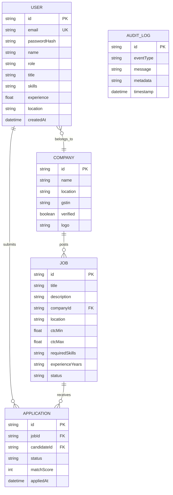
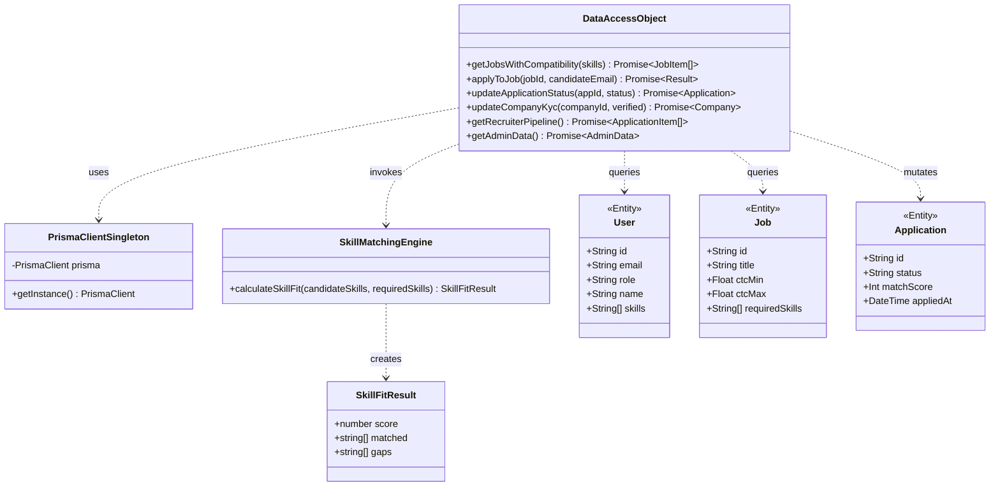

# TalentGrid India — Academic Project Report & Architecture Specifications

**Project Title:** TalentGrid India — Cloud-Native Engineering Recruitment & Skill-Matching Platform  
**Author:** Tarun Yadav  
**Architecture:** Object-Oriented / Domain-Driven Design (Next.js 16, TypeScript, Prisma ORM, SQLite)

---

## 1. System Use Case Diagram

```mermaid
flowchart TD
    subgraph Personas [TalentGrid Actors]
        Seeker["Job Seeker\n(e.g. Rohan Sharma / Self-Registered)"]
        Recruiter["Recruiter\n(e.g. Neha Verma / Self-Registered)"]
        Admin["Super Admin\n(e.g. Rajesh Kumar / Self-Registered)"]
    end

    subgraph AuthCases [Self-Registration & Onboarding Portal]
        UCR1["Register as Candidate (Skills, Experience, Location)"]
        UCR2["Register as Recruiter (Corporate Entity, GSTIN KYC)"]
        UCR3["Register as Super Admin (Master Passkey Auth)"]
    end

    subgraph SeekerCases [Candidate Workflows]
        UC1["Search & Filter Jobs by Tech Stack"]
        UC2["Inspect Real-time Skill Compatibility Score"]
        UC3["1-Click Job Application"]
        UC4["Preview & Print Auto-Generated CV"]
    end

    subgraph RecruiterCases [Recruiter Workflows]
        UC5["Post & Manage Engineering Requisitions"]
        UC6["Review Applicant Pipeline Ranked by % Fit"]
        UC7["Shortlist / Schedule Technical Interviews"]
    end

    subgraph AdminCases [Platform Governance]
        UC8["Verify Recruiter GSTIN / KYC"]
        UC9["Audit Security Event Logs BCrypt, RBAC"]
        UC10["Manage Platform Users & Roles"]
    end

    Seeker --> UCR1
    Recruiter --> UCR2
    Admin --> UCR3

    Seeker --> UC1
    Seeker --> UC2
    Seeker --> UC3
    Seeker --> UC4

    Recruiter --> UC5
    Recruiter --> UC6
    Recruiter --> UC7

    Admin --> UC8
    Admin --> UC9
    Admin --> UC10
```



---

## 2. Entity-Relationship (ER) Diagram



---

## 3. Class & Component Architecture Diagram



---

## 4. OOP Concepts & Viva Defense Cheat Sheet

When examiners ask how Object-Oriented and Software Engineering principles are demonstrated:

### A. Encapsulation
* **Prisma Model Schemas:** Direct SQL database mutation is blocked. All state transitions pass through strict TypeScript models (`schema.prisma`) with typed getters and setters.
* **Credential Protection:** Raw user passwords never enter the database or network packets; they are hashed with `bcryptjs` salt rounds before storage.

### B. Polymorphism (Dynamic Dispatch)
* **Runtime Dashboard Routing:** The main application dynamically dispatches different user experiences depending on the active user role (`CANDIDATE` renders dual-panel job discovery; `RECRUITER` renders candidate pipeline; `ADMIN` renders KYC verification and audit logs).
* **Polymorphic Action Handlers:** Methods like `updateApplicationStatus` dynamically accept varying status parameters (`SHORTLISTED`, `INTERVIEW_SCHEDULED`, `REJECTED`) while executing distinct audit log side effects.

### C. Abstraction & Interface Segregation
* **`SkillFitResult` Interface:** The calculation algorithm is completely decoupled from UI display components (`SkillMatrix`, `JobCard`).
* **Server Action Boundary (`src/app/actions.ts`):** Client components do not know or care whether the database is SQLite, PostgreSQL, or MySQL; all database calls are abstracted through clean async function signatures.

### D. Software Design Patterns
* **Singleton Pattern (`src/lib/prisma.ts`):** Ensures a single global instance of `PrismaClient` is maintained across Next.js hot-reloads, preventing database connection exhaustion.
* **DAO (Data Access Object) Pattern:** `src/app/actions.ts` encapsulates and abstracts all CRUD operations on `User`, `Job`, `Application`, and `AuditLog` entities.
* **Factory / Adapter Pattern:** `calculateSkillFit()` takes disparate raw input formats, sanitizes them, and produces a standardized `SkillFitResult` value object.

---

## 5. The 5-Minute Live Viva Walkthrough Script

Follow this step-by-step sequence during a live demo or examiner evaluation:

1. **Minute 1: The Candidate Journey**
   * Open `http://localhost:3000`. Show the active persona **Rohan Sharma (Candidate)**.
   * Highlight the **Real-Time 92% Skill Compatibility Engine** on the right panel. Explain that it compares Rohan's skills (Java 21, Spring Boot, Postgres, Docker) against the job requirements and flags Apache Kafka as a skill gap.
2. **Minute 2: 1-Click Apply & Auto-CV**
   * Click `⚡ Apply with Rohan Sharma's Profile`. Point out the reactive toast confirmation.
   * Click `Verified CV` in the navbar. Show the print-ready technical resume with `window.print()` PDF capability.
3. **Minute 3: The Recruiter Pipeline**
   * Click **Neha (Recruiter)** on the navbar without logging out.
   * Show that Rohan's application instantly appeared in the FinWave pipeline ranked at the top with `92% Fit`.
   * Click `Shortlist` or `Schedule Interview` to demonstrate live state update.
4. **Minute 4: Platform Governance & Super Admin**
   * Click **Rajesh (Admin)** on the navbar.
   * Show the pending KYC queue for Indian tech companies (e.g., Kavach Security). Click `Approve`.
   * Scroll through the **Audit Security Trail** showing real-time event logs for logins, applications, and KYC actions.
5. **Minute 5: Code & Architecture Proof**
   * Show the SQLite database file (`prisma/dev.db`).
   * Run the unit test suite in the terminal:
     ```bash
     npx tsx --test src/lib/__tests__/matching.test.ts
     ```
   * Show all 5 tests passing in 5ms, proving rigorous Test-Driven Development.
